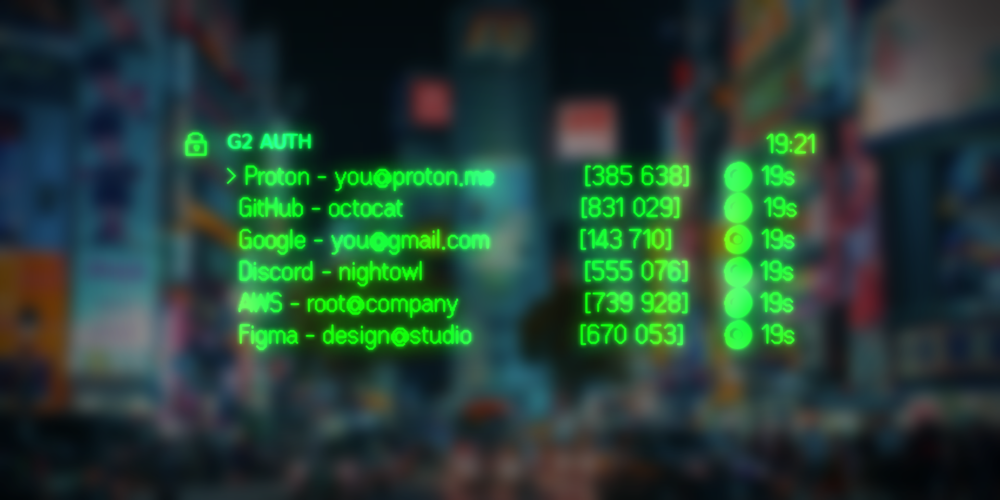
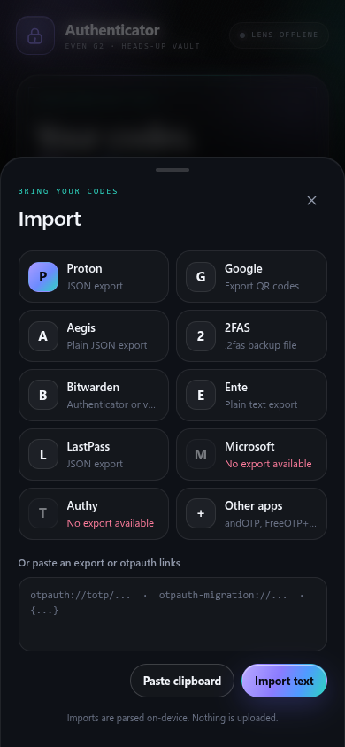
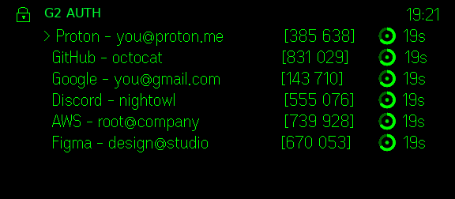

<div align="center">

# G2 AUTH

[](https://github.com/ARCANGEL0/even-auth/stargazers)
[](https://github.com/ARCANGEL0/even-auth/issues)



</div>

## What this app does

Import accounts from other authenticators and read their current codes on your phone or in the Even Realities G2 lens. Supported exports include Proton Authenticator, Google Authenticator, Aegis, 2FAS, Bitwarden, Ente Auth, LastPass Authenticator, andOTP, FreeOTP+, Stratum, and Raivo. Setup QR codes and `otpauth://` links work too.

Imports are parsed and codes are generated on the device. Account data stays in local app storage. The app does not upload it to a server.

## Import codes

Open **Import** from the home screen. Choose an app to see its export steps, then select the export file or QR images.

> **Proton Authenticator:** Export JSON from Settings and choose the file.

> **Google Authenticator:** Export accounts as QR codes, photograph each QR, then choose the images. You can also paste an `otpauth-migration://` link.

> **Aegis:** Export plain JSON with encryption turned off, then choose the file.

> **2FAS:** Export a file without a password, then choose the `.2fas` file.

> **Bitwarden:** Export vault JSON without encryption, then choose the file.

> **Ente Auth:** Export codes as plain text, then choose the file.

> **LastPass Authenticator:** Export accounts to a JSON file from Settings.

> **andOTP:** Create a plain text backup, then choose it.

> **FreeOTP+:** Export the accounts in JSON format.

> **Stratum:** Export a JSON backup without a password.

> **Raivo OTP:** Unzip the export and choose its JSON file.

For apps without an export, create a new setup QR code from the service and scan it with **Add account**.



## Add an account

Tap `Add +` and enter the service name, account name, and setup key. A live preview lets you check the code before saving. New accounts use SHA-1, six digits, and a 30 second period. Change those settings under **Advanced**.

Use the **Scan QR** tab to scan a setup code with the camera, take a photo, or choose an image from the album.

## On the glasses

Swipe the temple to change pages. Tap once to hide or reveal codes. Double tap to close the display.



## Build and test

Install dependencies and start the development server:

```bash
npm install
npm run dev
```

Build the app and run the tests:

```bash
npm run build
npm test
```

The tests cover RFC 6238 TOTP vectors, Base32 decoding, and importer fixtures in `tests/fixtures/`.

## Structure

```bash
.
├── src/
│   ├── main.ts         # App startup, imports, vault actions, and refresh loop
│   ├── totp.ts         # RFC 6238 code generation and account settings
│   ├── base32.ts       # Base32 secret decoding and normalization
│   ├── glasses.ts      # G2 lens layout, countdown rings, and page gestures
│   ├── phone.ts        # Phone vault interface
│   ├── add.ts          # Manual account form and QR scanning
│   ├── importers.ts    # Authenticator export parsers
│   ├── migration.ts    # Google Authenticator migration links
│   ├── qr.ts           # QR image decoding and camera capture
│   ├── sources.ts      # Import source instructions and app links
│   ├── storage.ts      # Local account and preference storage
│   ├── icons.ts        # Interface icons
│   └── style.css       # Phone interface styles
└── tests/
    ├── totp.test.ts       # RFC 6238 test vectors
    ├── importers.test.ts  # Import format fixtures
    └── fixtures/          # Sample authenticator exports
```
